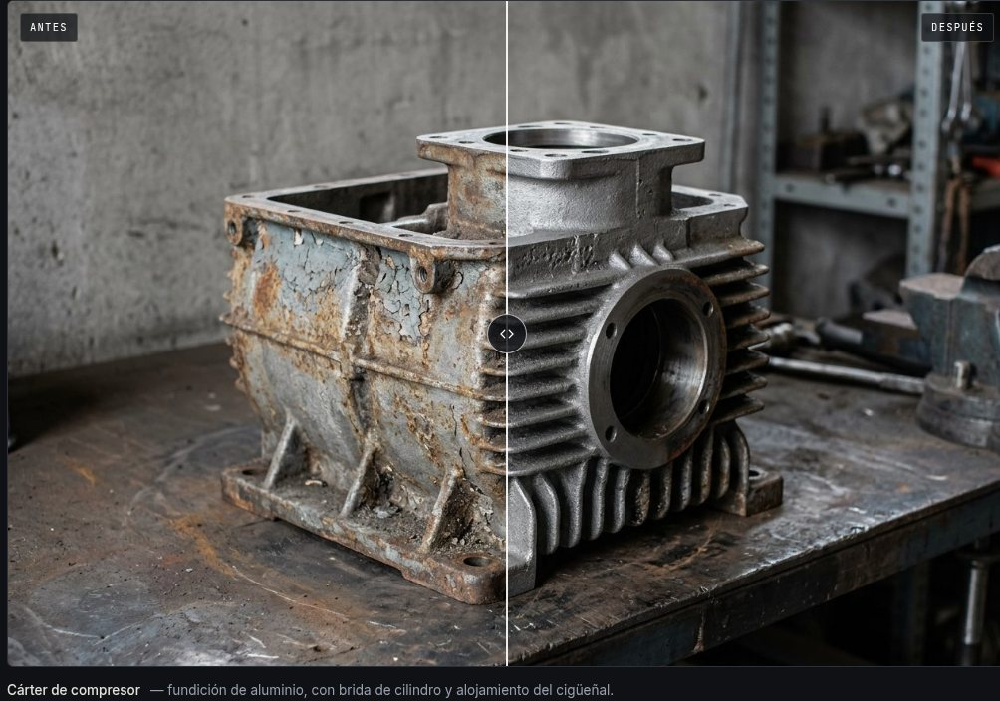

# arenados-web

Sitio web de una página para un servicio de arenado industrial en Zona Norte del Gran Buenos Aires, dirigido a compradores técnicos de talleres, plantas y áreas de mantenimiento.


## Qué es y para qué sirve

El comprador técnico que busca un servicio de arenado necesita verificar si el proveedor es apto para su pieza y conocer los plazos operativos. El sitio resuelve esta consulta en una sola vista sin navegación interna y presenta el formulario de contacto de forma directa:

- Detalla qué elementos se retiran (óxido, pintura vieja, suciedad adherida) y el estado final de la pieza (lista para pintar, soldar o evaluar).
- Muestra el resultado del proceso mediante un comparador visual de antes y después sobre cinco piezas distintas.
- Estructura el pedido de presupuesto con un formulario de cinco campos (tres obligatorios).

## Qué incluye

| Sección | Contenido |
| --- | --- |
| Portada | Propuesta de servicio, dos llamados a la acción y tres datos operativos |
| Proceso | Cuatro pasos: diagnóstico, preparación, arenado y control final |
| Aplicaciones | Piezas típicas por rubro: fundición, maquinaria, automotor y estructuras |
| Antes y después | Cinco comparadores interactivos con control deslizante |
| Cotización | Formulario de solicitud de presupuesto |
| Contacto | Teléfono, correo electrónico y dirección física |



## Decisiones técnicas

- **HTML, CSS y JavaScript sin dependencias**: Se descarta el uso de frameworks y empaquetadores para evitar `node_modules` y pasos de compilación. Permite editar y recargar directamente. El sitio completo pesa 1,8 MB (1,7 MB corresponden a las diez fotografías).
- **Comparador mediante recorte CSS (`clip-path: inset()`)**: Se descarta el uso de `<canvas>` o librerías externas. Usa dos imágenes superpuestas y una variable CSS, evitando cálculos de repintado. Responde a mouse, pantallas táctiles y teclado; sin JavaScript muestra ambas mitades al 50 %.
- **Tipografía única externa**: Se carga únicamente la familia Inter (cuatro pesos) desde Google Fonts. Para etiquetas y cifras se utiliza la fuente monoespaciada del sistema operativo, evitando la descarga de una segunda fuente.
- **Imágenes con carga diferida**: Diez archivos JPEG de 1264 × 848 px (entre 141 y 178 KB cada uno) con atributo `loading="lazy"`, excepto el primer par, para no bloquear la carga inicial.
- **Aparición de bloques con `IntersectionObserver`**: Se descarta la escucha del evento `scroll` para evitar ejecuciones continuas durante el desplazamiento. Las animaciones se desactivan si el sistema indica `prefers-reduced-motion`.
- **Envío de formulario mediante `fetch` con degradación a `mailto:`**: Se descarta la recarga de página del envío nativo. Envía un `POST` con `FormData` a un endpoint configurable; si el endpoint no está configurado, abre el cliente de correo local con el mensaje redactado. Incluye un campo oculto (honeypot) en lugar de CAPTCHA para filtrar bots sin intervención del usuario.

## Estructura

```text
assets/                            Diez JPEG de 1264 × 848: cinco pares antes/después
docs/comparador.jpg                Captura de la sección de comparación para documentación
docs/portada.jpg                   Captura de la portada para documentación
favicon-16.png                     Ícono de 16 px para pestaña de navegador
favicon-180.png                    Ícono de 180 px para pantalla de inicio en iOS
favicon-32.png                     Ícono de 32 px para pantallas de alta densidad
favicon.ico                        Ícono de respaldo para marcadores
index.html                         Documento principal con estructura, textos y metadatos
script.js                          Lógica del comparador, menú móvil, observador y formulario
scripts/hooks/pre-commit           Hook de Git para verificaciones previas al commit
styles.css                         Variables, maquetado, componentes y reglas adaptativas
```

## Cómo se usa

Alcanza con abrir `index.html` en el navegador. Para probarlo servido por HTTP, que es como se
comporta una vez publicado:

```bash
python3 -m http.server 8000
# http://127.0.0.1:8000
```

## Cómo se despliega

Al ser un sitio estático, no requiere servidor de aplicaciones ni base de datos:

- **Hosting tradicional**: Subir los archivos de la raíz y el directorio `assets/` respetando las rutas relativas.
- **Netlify, Vercel o Cloudflare Pages**: Conectar el repositorio sin comando de compilación y con la raíz (`/`) como directorio de salida.
- **GitHub Pages**: Publicar desde la rama `main` seleccionando la carpeta raíz (`/`).

En la configuración del servidor, asignar caché de larga duración a `assets/` y caché corta o sin caché a `index.html`.

## Estado del contenido

Las diez imágenes de la sección de comparación son ilustraciones generadas a modo de muestra; un aviso al pie de esa sección lo declara. Los datos de contacto (teléfono, correo y dirección) y la dirección de envío del formulario figuran como marcadores de posición que deben reemplazarse por los datos definitivos antes de publicar.
