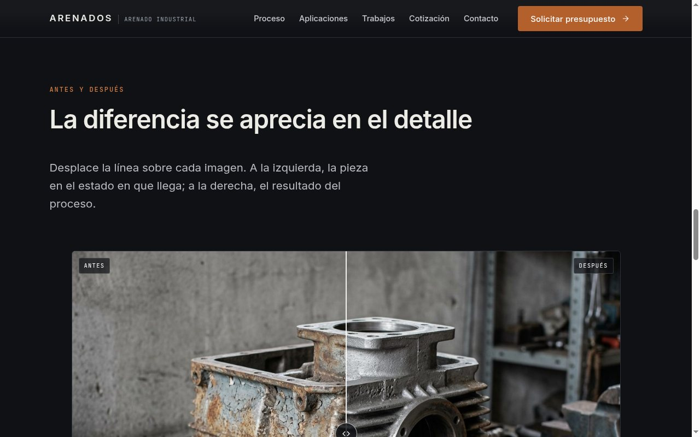

# Sitio web de Arenados

Sitio institucional de una página para un servicio de arenado industrial en Zona Norte del
Gran Buenos Aires. Presenta el servicio, muestra el resultado sobre piezas de taller y recibe
pedidos de presupuesto.



## Qué es y para qué sirve

El visitante es un comprador técnico —taller, planta, mantenimiento— que ya sabe qué es el
arenado y necesita resolver dos cosas: si este proveedor sirve para su pieza y cuánto tarda.
La página responde eso sin hacerlo navegar y le deja el formulario a mano.

Concretamente:

- Explica qué se retira (óxido, pintura vieja, suciedad adherida) y en qué estado queda la
  pieza: lista para pintar, soldar o evaluar.
- Muestra el resultado con un comparador antes/después sobre cinco piezas distintas.
- Ordena la consulta con un formulario de cinco campos, de los cuales tres son obligatorios.

## Qué incluye

| Sección | Contenido |
| --- | --- |
| Portada | Propuesta de servicio, dos llamados a la acción y tres datos operativos |
| Proceso | Cuatro pasos: diagnóstico, preparación, arenado y control final |
| Aplicaciones | Piezas típicas por rubro: fundición, maquinaria, automotor y estructuras |
| Antes y después | Cinco comparadores con control deslizante |
| Cotización | Formulario de presupuesto |
| Contacto | Teléfono, correo y dirección |


## Decisiones técnicas

**Sin dependencias ni compilación.** HTML, CSS y JavaScript plano. No hay `node_modules`, ni
paso de build, ni framework: se edita un archivo y se recarga. El sitio completo pesa 1,8 MB,
de los cuales 1,7 MB son las diez imágenes del comparador.

**El comparador son dos imágenes superpuestas.** No hay canvas ni librería de comparación: las
dos fotos están en el mismo encuadre y el control mueve un recorte (`clip-path: inset()`) sobre
la capa superior. Son dos imágenes y una variable de CSS. Responde al mouse, al dedo y a las
flechas del teclado, y sin JavaScript queda dividido al 50 %.

**Una sola descarga de fuentes.** Inter con cuatro pesos desde Google Fonts; las etiquetas y
las cifras usan la monoespaciada del sistema, así que no hay una segunda familia que cargar.

**Imágenes optimizadas.** Diez JPEG de 1264 × 848, de entre 141 y 178 KB, con carga diferida
(`loading="lazy"`) salvo las del primer comparador.

**Animaciones sin costo por scroll.** Las apariciones se disparan con `IntersectionObserver`
cuando el bloque entra en pantalla, en lugar de escuchar el evento de scroll. Todo el
movimiento se anula con `prefers-reduced-motion`.

**El formulario no recarga la página.** Valida en el navegador, muestra el error debajo del
campo y envía con `fetch` a un endpoint configurable: sirve cualquier servicio que acepte un
`POST` con `FormData`. Si el endpoint conserva el marcador, arma la consulta y abre el cliente
de correo con el texto ya redactado. Incluye un campo trampa invisible para los bots que
completan todo lo que encuentran.

**Accesibilidad resuelta en el maquetado.** Foco visible en todos los controles, etiquetas
asociadas a cada campo, nombre accesible en el control del comparador y avisos del formulario
anunciados con `role="status"`. Los textos principales superan 15:1 de contraste.

**Íconos por densidad.** PNG de 16, 32 y 180 px más un ICO de respaldo para marcadores viejos,
todos con el mismo monograma.

## Estructura

```
index.html       página completa: secciones, textos y metadatos
styles.css       sistema visual: variables, componentes y responsive
script.js        comparador, menú móvil, animaciones y formulario
favicon-16.png   16 px, pestaña
favicon-32.png   32 px, pantallas de alta densidad
favicon-180.png  180 px, pantalla de inicio en iOS
favicon.ico      respaldo para marcadores
assets/          diez JPEG del comparador, 1264 × 848
docs/            capturas usadas en este README
```

## Cómo verlo

Alcanza con abrir `index.html` en el navegador. Para probarlo servido por HTTP, que es como se
comporta una vez publicado:

```bash
python3 -m http.server 8000
# http://127.0.0.1:8000
```

## Cómo publicarlo

Es un sitio estático: no necesita servidor de aplicaciones ni base de datos.

- **Hosting compartido**: subir el contenido respetando la carpeta `assets/`.
- **Netlify, Vercel o Cloudflare Pages**: conectar el repositorio; no hay comando de build ni
  directorio de salida que configurar.
- **GitHub Pages**: requiere repositorio público, rama `main` y carpeta raíz.

Conviene cachear `assets/` por mucho tiempo y `index.html` por poco, para no servir versiones
viejas.

## Contenido

Las imágenes del comparador son ilustraciones generadas y la página lo declara en un aviso al
pie de esa sección. Los datos de contacto del pie son provisorios: el sitio queda listo para
publicarse cuando se reemplacen por los reales.
